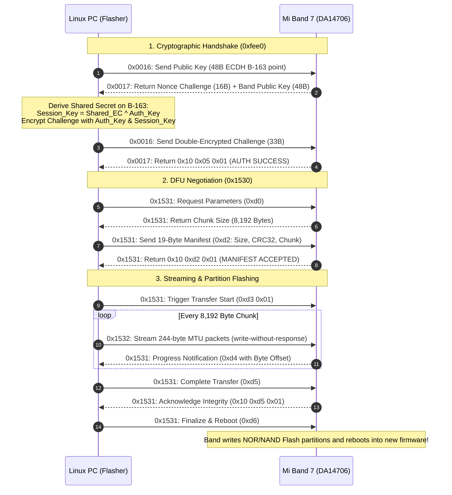

# ⚡ Xiaomi Smart Band 7 Standalone BLE Firmware Flasher

[](https://opensource.org/licenses/MIT)
[](https://www.python.org/downloads/)
[](https://www.bluez.org/)
[](https://www.renesas.com/)
[](https://docs.zepp.com/)

A fully automated, educational, and user-friendly tool to flash official and custom firmware to the **Xiaomi Smart Band 7** (`M2129B1` / `M2130B1` NFC) directly over **Bluetooth Low Energy (BLE)** from a Linux PC — **no smartphone, Zepp Life, or Mi Fitness app required.**

---

## 🌟 Why This Project?

Official smartphone companion apps enforce region checks, staged rollouts, and prevent direct firmware sideloading or downgrades. This tool gives you full control over your hardware by implementing the raw **Zepp OS Over-The-Air (DFU) protocol** and **NIST B-163 Elliptic Curve Cryptography** directly against the band's Bluetooth stack.

### Key Features:
- 🚀 **1-Click Interactive Wizard:** Easy step-by-step guidance for beginners.
- 🤖 **Full Automation Mode:** Complete headless flashing for automated pipelines and scripts.
- 🔑 **Built-in Auth Key Extractor:** Securely retrieves your 16-byte pairing token from your Xiaomi / Google account.
- 📥 **Direct CDN Downloader:** Automatically downloads verified official firmware packages (`v2.2.0.1`, `v2.0.0.2`) from Xiaomi servers with CRC32 verification.
- 🔒 **Hardware Cryptography:** Implements the modern 2021+ ECDH B-163 curve handshake and AES-128 challenge-response required by the Renesas DA14706 SoC.
- 📊 **Real-Time Progress & Telemetry:** Dynamic live transfer bar with speed metrics (KB/s), elapsed time, and ETA.
- 🩺 **Hardware Diagnostics:** Queries battery voltage, hardware revision, serial number, and active firmware version.

---

## 🏗️ How It Works (Protocol Architecture)



---

## ⚡ Quick Start (Beginner Friendly)

### 1. Install Prerequisites
On Debian / Ubuntu / Kali / Raspberry Pi OS:
```bash
sudo apt update
sudo apt install -y bluez python3-dbus python3-gi default-jdk python3-pip git
sudo systemctl start bluetooth
```

### 2. Clone the Repository
```bash
git clone https://github.com/Itszeeshanrajput/miband7-ble-flasher.git
cd miband7-ble-flasher
pip3 install -r requirements.txt
```

### 3. Launch the Interactive Flasher
```bash
python3 flasher.py
```

The tool will display an interactive menu:
```text
╔══════════════════════════════════════════════════════════════════════╗
║        Xiaomi Smart Band 7 (Mi Band 7) Standalone BLE Flasher        ║
║   ECDH B-163 Cryptographic Auth & Zepp OS Over-The-Air DFU Engine     ║
╚══════════════════════════════════════════════════════════════════════╝

Select an option:
  [1] 🚀 Auto-Flash Firmware (Full Pipeline)
  [2] 🔑 Extract Auth Key from Xiaomi Account
  [3] 📥 Download Official Firmware Package
  [4] 🔍 Scan & Diagnose Device
  [5] 🚪 Exit
```

---

## 🤖 Automated Headless Mode (Power Users & CI)

If you already know your band's Bluetooth MAC address, Auth Key, and have the firmware file:

```bash
python3 flasher.py \
  --mac E8:3F:50:64:CB:CB \
  --auth-key a83d54bf0287bec3a74c436dcb75f4cd \
  --file ./firmware/miband7_std_2.2.0.1.zip \
  --auto
```

---

## 🔑 How to Get Your 16-Byte Auth Key

Every modern Xiaomi / Huami wearable requires a **16-byte cryptographic secret** (Auth Key) to unlock its Bluetooth GATT services.

1. In `flasher.py`, select **Option `[2]`**.
2. It will open Xiaomi's official OAuth authorization page in your browser.
3. Log in with the Xiaomi / Google account that is paired to your Mi Band 7.
4. After logging in, you will be redirected to a URL starting with:
   `https://hm.xiaomi.com/watch.do?code=...`
5. Copy and paste that full redirect URL into the prompt.
6. The tool automatically exchanges the token and prints your band's 16-byte Auth Key, saving it to `config.json` for future sessions!

---

## 📦 Supported Official Firmware Packages

| Version | Device Model | Codename | Package Size | Hardware CRC32 | Status |
| :--- | :--- | :--- | :--- | :--- | :--- |
| **`v2.2.0.1`** | Standard (`M2129B1`) | `hmpace.watch.v7` | 22.45 MB | `0x978d2100` | ✅ Verified Stable |
| **`v2.2.0.1`** | NFC (`M2130B1`) | `hmpace.watch.v7nfc` | 22.45 MB | `0x978d2100` | ✅ Verified Stable |
| **`v2.0.0.2`** | Standard (`M2129B1`) | `hmpace.watch.v7` | 21.30 MB | — | ✅ Verified Stable |

---

## 📚 Deep-Dive Documentation

For engineers, security researchers, and developers wanting to understand the inner workings:
- [Hardware Architecture & Memory Layout](docs/ARCHITECTURE.md) — Renesas DA14706 SoC, Dual NOR/NAND Flash, and Zepp OS 1.0 subsystem.
- [BLE GATT Services & Protocol Reference](docs/PROTOCOL.md) — Byte offsets, 19-byte manifest structure, and packet fragmentation.
- [Troubleshooting & Error Codes](docs/TROUBLESHOOTING.md) — Explanations for errors `0x03`, `0x22`, `0x25`, `0x26`, and `0x47`.

---

## ⚠️ Safety Guidelines & Best Practices

- **Battery Voltage:** Always ensure your band has **at least 30% battery** before flashing. The bootloader rejects updates below 20% (Error `0x22`) to prevent accidental power loss during Flash sector writes.
- **Proximity:** Keep the band within **1 meter** of your computer during the transfer.
- **Charging Cable:** Placing the band on its magnetic charging cable during flashing is recommended.

---

## 📄 License

This project is licensed under the [MIT License](LICENSE).
Built for educational, research, and device interoperability purposes.
