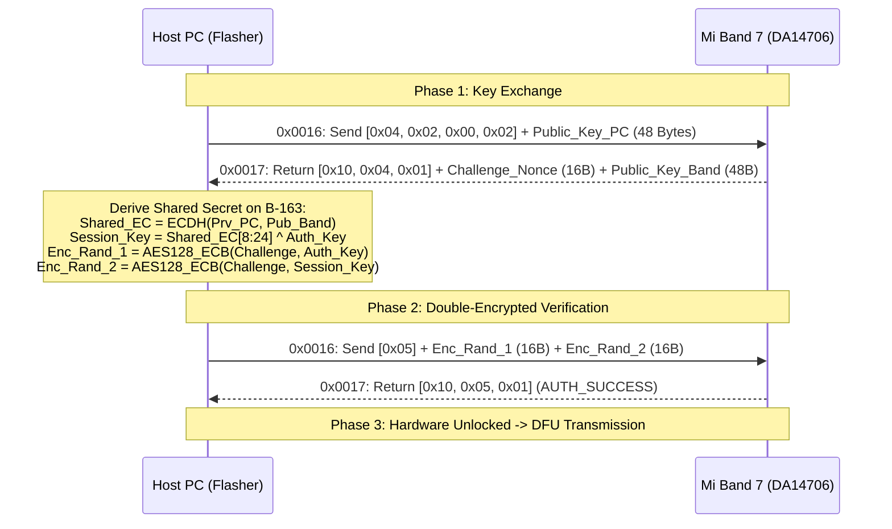

# Xiaomi Smart Band 7 Architecture & Internal Specifications

This document details the hardware architecture, operating system design, cryptographic implementation, and memory layout of the **Xiaomi Smart Band 7** (`M2129B1` / `M2130B1` NFC).

---

## 1. Hardware Overview

```
                      +------------------------------------------+
                      |         Renesas / Dialog DA14706         |
                      |                                          |
                      |  +-------------------+  +--------------+ |
                      |  | ARM Cortex-M33F   |  | Cortex-M0+   | |
                      |  | @ 160 MHz (App)   |  | @ 32 MHz SNC | |
                      |  +-------------------+  +--------------+ |
                      |                                          |
                      |  +-------------------+  +--------------+ |
                      |  | NeoChrom 2D GPU   |  | BLE 5.2 Base | |
                      |  | 2.5D Accelerator  |  | Band Subsys  | |
                      |  +-------------------+  +--------------+ |
                      |                                          |
                      |  +-------------------+                   |
                      |  | 8 MB On-Chip PSRAM|                   |
                      |  +-------------------+                   |
                      +--------------------+---------------------+
                                           | QSPI
             +-----------------------------+-----------------------------+
             |                                                           |
+------------v------------+                                 +------------v------------+
|    8 MB NOR Flash       |                                 |    128 MB NAND Flash    |
| (Bootloader, Firmware,  |                                 | (JS Apps, Watchfaces,   |
| System OS, Fonts)       |                                 | Assets, Health Logs)    |
+-------------------------+                                 +-------------------------+
```

### Key Components:
- **Application Processor:** ARM Cortex-M33F running at up to 160 MHz with Hardware Floating Point Unit (FPU) and TrustZone security.
- **Sensor Node Controller (SNC):** Independent ARM Cortex-M0+ running at 32 MHz for ultra-low power continuous PPG heart rate and accelerometer sampling.
- **Display Controller:** 2D NeoChrom GPU powering the 1.62-inch 192×490 AMOLED display at 326 PPI and 500 nits.
- **Flash Architecture:** Dual storage system combining fast execute-in-place (XIP) NOR Flash with high-capacity NAND Flash for Zepp OS watchapps.

---

## 2. Operating System: Zepp OS 1.0

The Mi Band 7 runs Huami's **Zepp OS 1.0**, a lightweight RTOS optimized for low-power wearables:
- **Kernel:** Proprietary microkernel with pre-emptive multitasking.
- **Application Engine:** JerryScript-derived lightweight JavaScript runtime running `.zpk` and `.zab` watchapps.
- **Resource System:** Direct memory-mapped image decompression and bitmap rendering pipelines.

---

## 3. Cryptographic Authentication Protocol (2021+ Protocol)

Unlike legacy Mi Band 2–6 devices which used simple AES-128 challenge-response on Characteristic `0x0009`, modern Zepp OS devices employ an **Elliptic Curve Diffie-Hellman (ECDH)** key agreement over the **NIST B-163** binary curve (`sect163r2`).

### 3-Phase Handshake Flow:



### NIST B-163 Curve Equations:
- Equation: $y^2 + xy = x^3 + x^2 + b$ over $\text{GF}(2^{163})$
- Field Polynomial: $f(x) = x^{163} + x^7 + x^6 + x^3 + 1$
- Private Key: 24 random bytes (192 bits, masked to degree 163)
- Public Key Point $(X, Y)$: 48 bytes (24 bytes for X, 24 bytes for Y)
